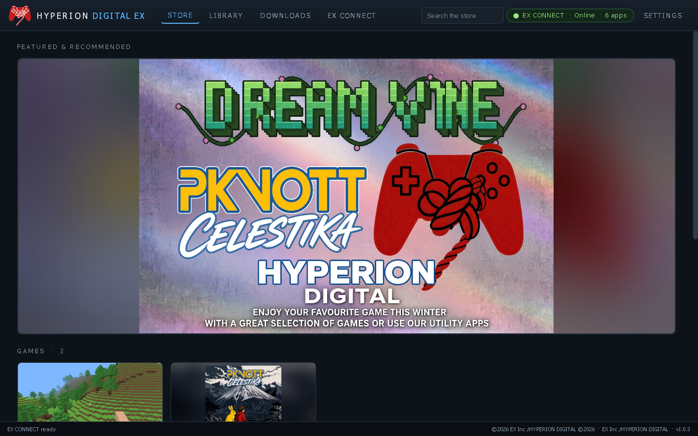
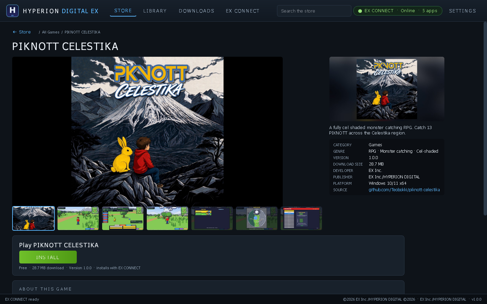
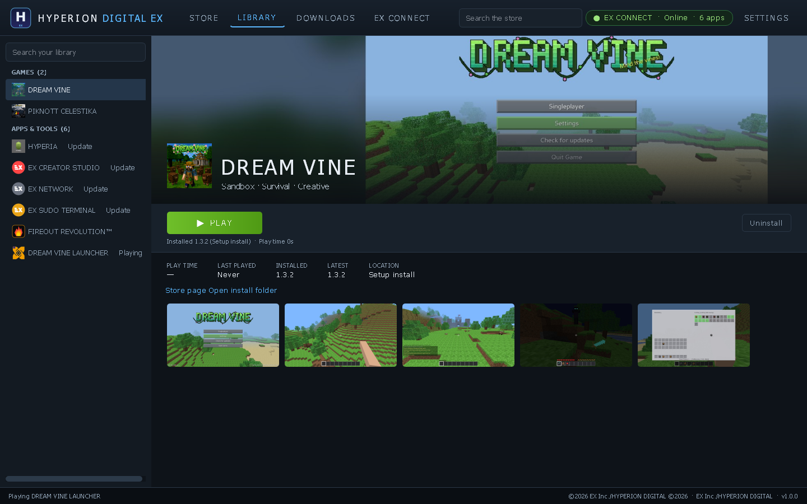
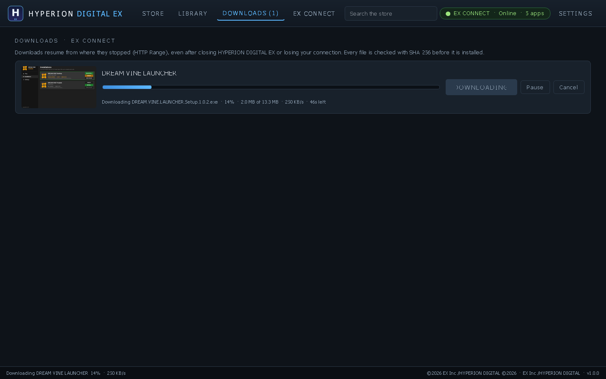
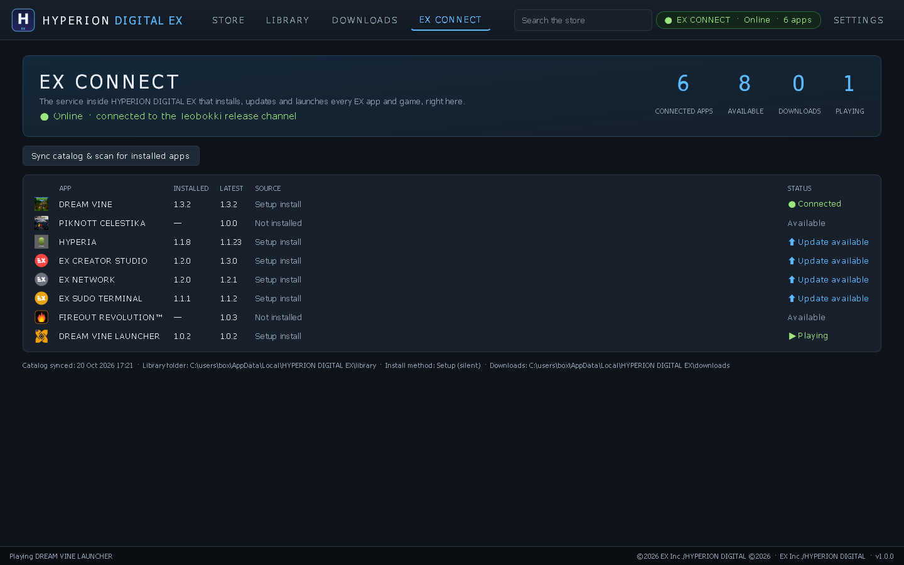
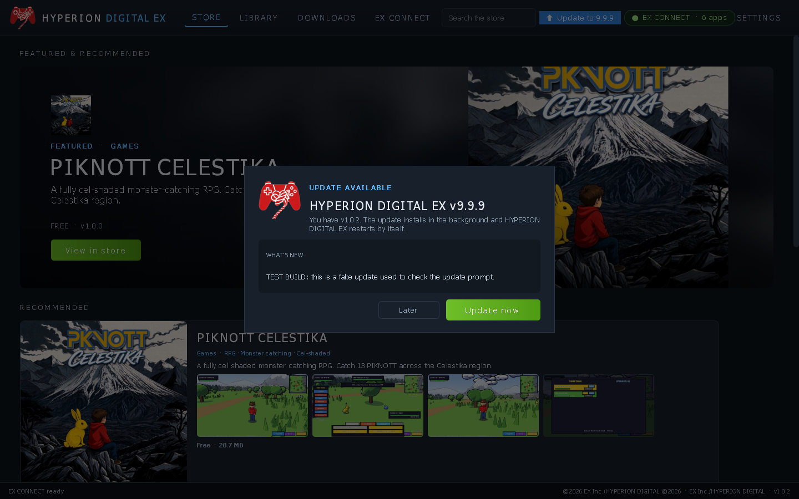

# HYPERION DIGITAL EX

The EX Inc. store and library for Windows. Every EX game and app is in one storefront, and **EX CONNECT** installs, updates and launches each one right inside HYPERION DIGITAL EX.

## Features
- **Store**: a featured carousel, Games and Apps & Tools sections, search, and product pages with a screenshot gallery, description, features, version, download size and What's new.
- **Library**: every app with its icon, Play / Install / Update / Uninstall, play time, last played, installed vs latest version and install location.
- **EX CONNECT**:
  - Reads each app's `latest.json` and release from github.com/Teobokki.
  - One-click **Install** downloads the Setup with a progress bar and checks it with SHA-256 (against the GitHub release digest). Then it installs silently (`/VERYSILENT /SUPPRESSMSGBOXES /NORESTART`). Alternatively it can extract the full zip into `%LOCALAPPDATA%\HYPERION DIGITAL EX\library\<app>`.
  - Downloads are **resumable** (HTTP Range). You can pause, resume or cancel them, and they carry on after a restart or a dropped connection, so they work on very slow links.
  - Detects copies you already have: Setup installs (Apps & features / `%LOCALAPPDATA%\Programs\<App>`), library installs and portable exes in Downloads.
  - **Play** launches the app, shows *Playing* and tracks play time. **Update** appears when `latest.json` has a newer version.
  - Status badge and an EX CONNECT panel (online/offline, connected apps).
- **Settings**: library folder, install method, and launch on Windows startup (off by default).
- **Check for updates** for HYPERION DIGITAL EX itself via this repo's `latest.json`.

| | |
|---|---|
|  |  |
|  |  |

## Catalog
Games: DREAM VINE, PIKNOTT CELESTIKA. Apps & Tools: HYPERIA, EX CREATOR STUDIO, EX NETWORK, EX SUDO TERMINAL, FIREOUT REVOLUTION™, DREAM VINE LAUNCHER.
Icons and screenshots are each app's own artwork, bundled from its source. The HYPERION DIGITAL EX icon is EX Inc.'s own artwork (`assets/icon_source_user.png`).

## What's new in 1.0.3
- Featured & Recommended now has a single card: EX Inc.'s winter promo banner, shown whole (3:2). Clicking it jumps to the Games section.

## What's new in 1.0.2
- Featured & Recommended now shows only PIKNOTT CELESTIKA: one featured card, plus a new Recommended row.
- HYPERION DIGITAL EX checks for its own updates a few seconds after launch and every 30 minutes. When a new version is out, it asks: **Update now** downloads the Setup (resumable, SHA-256 checked), installs it silently and restarts the app; **Later** won't ask again this session. Check for updates in Settings still works.

## What's new in 1.0.1
- New app icon (EX Inc. artwork) for the exe, installer, window/taskbar, top-bar logo and shortcuts.

## Download
From [Releases](https://github.com/Teobokki/hyperion-digital-ex/releases/latest):
- `HYPERION.DIGITAL.EX.Setup.1.0.3.exe`: the installer. It installs per user, needs no admin, and adds Start menu and optional desktop shortcuts.
- `HYPERION.DIGITAL.EX.Portable.exe`: a single-file portable exe.
- `HYPERION.DIGITAL.EX.1.0.3.Windows.x64.zip`: the full app folder.

The app is unsigned, so SmartScreen may warn you: **More info → Run anyway**.

## Build
Python 3.11 + PySide6, PyInstaller and Inno Setup 6 (under Wine): `python3 tools/make_assets.py && bash build.sh`.

©2026 EX Inc./HYPERION DIGITAL ©2026 · Publisher: EX Inc./HYPERION DIGITAL
