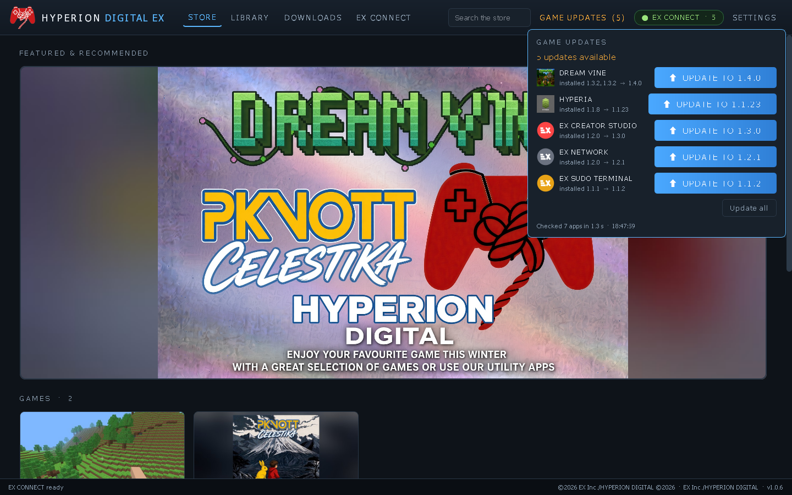
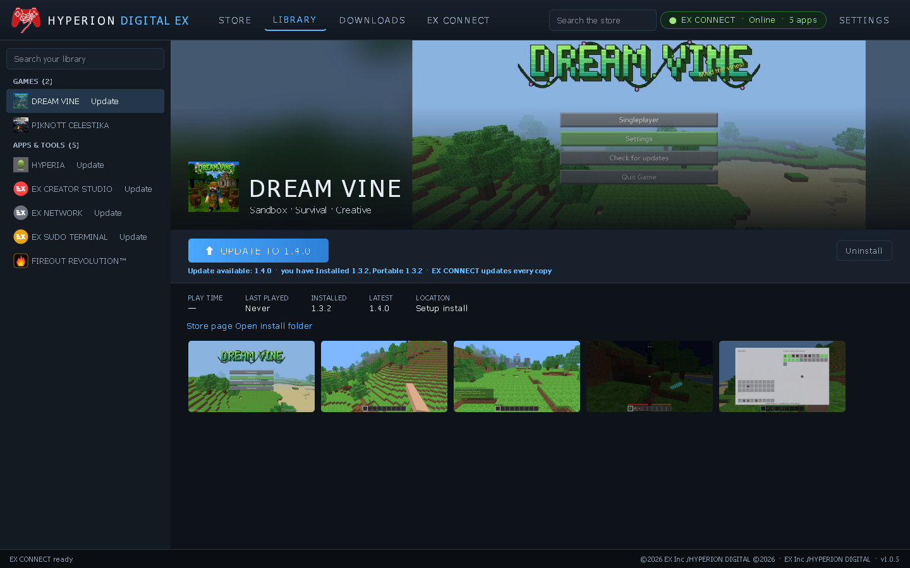

# HYPERION DIGITAL EX

The EX Inc. store and library for Windows. Every EX game and app is in one storefront, and **EX CONNECT** installs, updates and launches each one right inside HYPERION DIGITAL EX.

## Features
- **Store**: a featured carousel, Games and Apps & Tools sections, search, and product pages with a screenshot gallery, description, features, version, download size and What's new.
- **Library**: every app with its icon, Play / Install / Update / Uninstall, play time, last played, installed vs latest version and install location.
- **EX CONNECT**:
  - Reads each app's `latest.json` and release from github.com/Teobokki.
  - One-click **Install** downloads the Setup with a progress bar and checks it with SHA-256 (against the GitHub release digest). Then it installs silently (`/VERYSILENT /SUPPRESSMSGBOXES /NORESTART`). Alternatively it can extract the full zip into `%LOCALAPPDATA%\HYPERION DIGITAL EX\library\<app>`.
  - Downloads are **resumable** (HTTP Range). You can pause, resume or cancel them, and they carry on after a restart or a dropped connection, so they work on very slow links.
  - Detects copies you already have: Setup installs (Apps & features / `%LOCALAPPDATA%\Programs\<App>`), library installs and portable exes in Downloads.
  - **Play** launches the app, shows *Playing* and tracks play time. **Update** appears when `latest.json` has a newer version.
  - Status badge and an EX CONNECT panel (online/offline, connected apps).
- **Settings**: library folder, install method, and launch on Windows startup (off by default).
- **Check for updates** for HYPERION DIGITAL EX itself via this repo's `latest.json`.

| | |
|---|---|
|  |  |
|  |  |

## Catalog
Games: THE ANULMENT, ファイアアウト・シャイン (FIREOUT SHINE), EX SPORTS™ SFC 27 STANDARD EDITION, DREAM VINE, PIKNOTT CELESTIKA. Apps & Tools: HYPERIA, EX CREATOR STUDIO, EX NETWORK, EX SUDO TERMINAL, FIREOUT REVOLUTION™.
Icons and screenshots are each app's own artwork, bundled from its source. The HYPERION DIGITAL EX icon is EX Inc.'s own artwork (`assets/icon_source_user.png`).

## Adding or changing a store title (no store rebuild)
The store's title list is **remote**: `catalog/catalog.json` on `main` plus the art in `assets/apps/<id>/`. HYPERION DIGITAL EX 1.1.11+ reads them at main's current commit, so the change shows up live. That happens on startup, on window focus, every 10 minutes, on **CHECK FOR UPDATES** and on **CHECK FOR STORE UPDATES**. Users don't need a new store release or a restart.

1. Put the art in `assets/apps/<id>/`: `icon.png`, `capsule.jpg`, `hero.jpg`, `shot0.jpg`, `shot1.jpg`, … Square key art can also use `cover.jpg` + `hero_bg.jpg`. Names are lowercase `[a-z0-9_]` and `.png`/`.jpg`, and each file is up to 15 MB.
2. Add or edit the entry in `catalog/catalog.json` → `titles`:
   - `id`: lowercase, e.g. `my-game`. `name`. `row`: `GAMES` or `APPS`.
   - `genre`, `tagline`, `description`, `features` (list).
   - `publisher`, `developer`, `release`.
   - `repo`: the game's GitHub repo under Teobokki.
   - `latest_url`: `https://raw.githubusercontent.com/Teobokki/<repo>/main/latest.json`.
   - `app_id` and `reg`: the Inno Setup uninstall key, i.e. the AppId + `_is1`. `AppId={{X}` gives `{X}_is1`; `AppId={{X}}` gives `{X}}_is1`.
   - `exe`, `folder` (the `%LOCALAPPDATA%\Programs\<folder>` name) and `portable` (Downloads exe names).
   - `version`: shown only while offline.
   - Optional: `featured` (ids shown in Featured & Recommended), `known_sizes`, `catalog_version` (bump it on each change).
3. Run `python tools/make_catalog.py`. It fills in each art file's `size` + `sha256` and validates the file with the store's own rules. Entries it would skip are printed as WARNING.
4. Commit and push `catalog/catalog.json` and `assets/apps/<id>/` to `main`. That's it.

The rules the store applies:
- Every entry is validated. A bad entry is skipped and never crashes the store.
- Unknown fields are ignored (`schema` 1; newer schemas are read too).
- Art is downloaded only when its size/sha256 changed, and it is cached in `%LOCALAPPDATA%\HYPERION DIGITAL EX\catalog\`.
- Downloads are allowed only from `github.com/Teobokki`.
- When it is offline, the store uses the last saved catalog. On the very first run it uses the built-in one (`ex_catalog.py`).
- New titles get a **NEW** badge for 14 days.

## What's new in 1.1.11
The store catalog is remote (see above). New **CHECK FOR STORE UPDATES** button in UPDATES, next to CHECK FOR UPDATES: it fetches the catalog and art fresh, refreshes the Store and Library live, and says "Store updated: 1 new title" or "Store is up to date".

## What's new in 1.1.10

Game updates are detected again: latest.json read live at main's commit, installed versions from each title's AppId key + exe version, checks on startup / focus / CHECK FOR UPDATES / every 10 min, local rescan every 15 s, new UPDATES page, single instance.

## What's new in 1.1.9
- New in the store: **THE ANULMENT** 1.0.0 by EX Inc./HYPERION DIGITAL (Games · Story · Open world · Investigation). Chapter 1 of a rainy-night story game in the fictional country of Valdora: protest, evidence, police pursuits, the EX IX G10 phone and T chat with an offline Romanian voice. The listing uses the game's own start-screen artwork as its icon and art. It installs per-user from the game's Setup with no admin rights, portable copies are detected, and updates come through the game's own latest.json.

## What's new in 1.1.8
- Fixed the UPDATE button that never cleared for games with 4-part versions. FIREOUT SHINE 1.0.5.1 was read as 1.0.5. Installed versions are now read and compared with all four parts.
- Fixed the "Failed to remove temporary directory (_MEI…)" warning. Games, Setups and the self-update restart now start with a clean environment.

## What's new in 1.1.7
- New in the store: **EX SPORTS™ SFC 27 STANDARD EDITION** 1.0.0 by EX Inc. (Games · Sports · Football · Online). It's 7-a-side football against the AI, or online with friends using SFC27 join codes, with fictional clubs and unlimited matches. The listing has its own icon, cover, hero and 8 screenshots. It installs per-user from the game's Setup with no admin rights, and portable copies are detected too. Updates come through the game's own latest.json.
- Product pages now show each title's own publisher.

## What's new in 1.0.7

- Fixed the duplicated publisher in the footer: it now reads "©2026 EX Inc./HYPERION DIGITAL ©2026 · v1.0.7". The Settings page no longer repeats the publisher either.

## What's new in 1.0.6
- New **GAME UPDATES** button in the top bar. It re-checks every app's latest.json and installed version in parallel (about 1.5 s, cache-busted), then shows 'All games and apps are up to date' or a list with **UPDATE TO x.y.z** buttons and **Update all**. When updates are found, the button shows how many.
- The automatic background check now runs every 5 minutes, with no popup for library apps.

## What's new in 1.0.5
- Clear **UPDATE TO x.y.z** button and an 'Update available' line in the Library and on product pages whenever an installed copy is older than the app's latest.json.
- Versions are read from each exe's own version info first, then the Apps & features entry. Portable copies in Downloads are tracked next to Setup installs, and one Update click updates every outdated copy.
- The catalog is refreshed when the app opens and every 30 minutes, so new releases show up without restarting.

## What's new in 1.0.4
- DREAM VINE LAUNCHER is no longer listed. DREAM VINE itself is unchanged, and an installed launcher is left untouched.

## What's new in 1.0.3
- Featured & Recommended now has a single card: EX Inc.'s winter promo banner, shown whole (3:2). Clicking it jumps to the Games section.

## What's new in 1.0.2
- Featured & Recommended now shows only PIKNOTT CELESTIKA: one featured card, plus a new Recommended row.
- HYPERION DIGITAL EX checks for its own updates a few seconds after launch and every 30 minutes. When a new version is out, it asks: **Update now** downloads the Setup (resumable, SHA-256 checked), installs it silently and restarts the app; **Later** won't ask again this session. Check for updates in Settings still works.

## What's new in 1.0.1
- New app icon (EX Inc. artwork) for the exe, installer, window/taskbar, top-bar logo and shortcuts.

## Download
From [Releases](https://github.com/Teobokki/hyperion-digital-ex/releases/latest):
- `HYPERION.DIGITAL.EX.Setup.1.0.7.exe`: the installer. It installs per user, needs no admin, and adds Start menu and optional desktop shortcuts.
- `HYPERION.DIGITAL.EX.Portable.exe`: a single-file portable exe.
- `HYPERION.DIGITAL.EX.1.0.7.Windows.x64.zip`: the full app folder.

The app is unsigned, so SmartScreen may warn you: **More info → Run anyway**.

## Build
Python 3.11 + PySide6, PyInstaller and Inno Setup 6 (under Wine): `python3 tools/make_assets.py && bash build.sh`.

©2026 EX Inc./HYPERION DIGITAL ©2026
